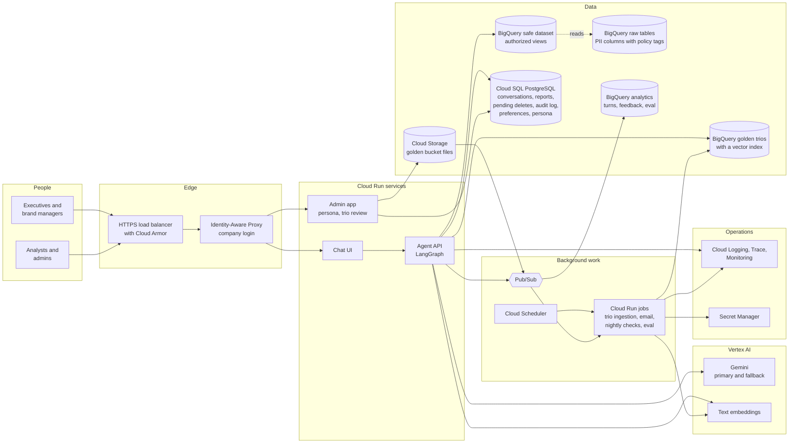
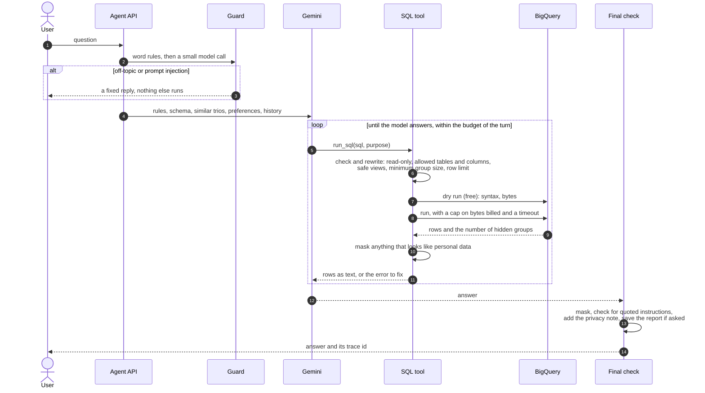
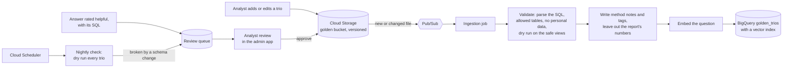
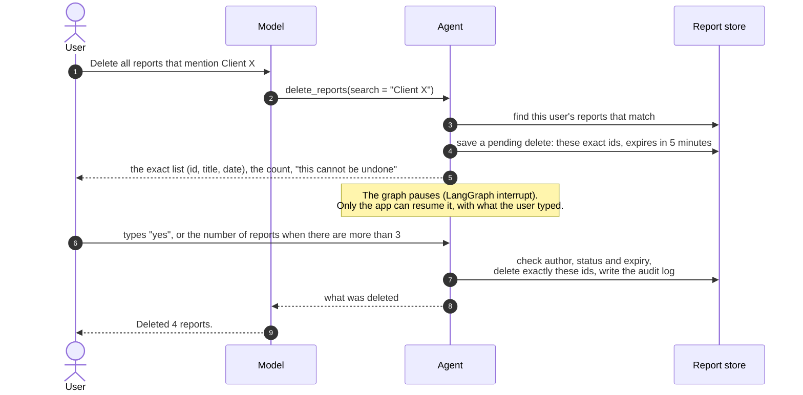

# Architecture: High-Level Design

This document is the production design of the data analysis chat assistant, and it explains
how the prototype in this repository maps to it. Each section says what the prototype does
today (in code, tested) and what production adds.

**In short, for a non-technical reader:**

- Executives and brand managers ask questions in plain language. The assistant writes SQL,
  runs it in BigQuery and answers with numbers, an explanation and, when asked, a report with
  action items.
- Each person sees only their own brands. Names, emails, addresses and exact locations never
  leave the data warehouse, and groups of fewer than 5 customers are hidden.
- Deleting saved reports always shows the exact list first and needs a typed confirmation.
- When a model or a service fails, the assistant switches to a backup or explains plainly what
  went wrong. Every step of every answer is traced, without storing the text.
- It learns from analysts' past work (the Golden Bucket) and from user feedback. A person
  reviews every change before it reaches users.

## Contents

1. [Architecture](#1-architecture)
2. [Models, framework and tools](#2-models-framework-and-tools)
3. [One turn, step by step](#3-one-turn-step-by-step)
4. [The eight requirements](#4-the-eight-requirements)
5. [Security](#5-security)
6. [Where data lives](#6-where-data-lives)
7. [Scale, limits and cost](#7-scale-limits-and-cost)
8. [Reliability](#8-reliability)
9. [Delivery](#9-delivery)
10. [Extensibility: a new capability is a new tool](#10-extensibility-a-new-capability-is-a-new-tool)
11. [Risks and known limits](#11-risks-and-known-limits)
12. [Rollout plan](#12-rollout-plan)

### What is built and what is designed

The assignment asks for four requirements in code and the rest as design.

| Requirement | In the prototype (this repo) | Production design |
|---|---|---|
| 1. Hybrid intelligence (Golden Bucket) | Design only. The analysts' definitions are in the system prompt | [4.1](#41-hybrid-intelligence-the-golden-bucket) |
| 2. Safety and PII | Built: guard, SQL checks, safe views, minimum group size, masking, final check | [4.2](#42-safety-and-pii) |
| 3. Destructive operations | Built: exact list, expiry, typed confirmation, hard delete, audit log | [4.3](#43-high-stakes-oversight-deleting-reports) |
| 4. Learning loop | Design only | [4.4](#44-continuous-improvement-the-learning-loop) |
| 5. Resilience | Built: self-correction, budget per turn, retries, fallback model, cooldown | [4.5](#45-resilience-and-graceful-error-handling) |
| 6. Quality assurance | Built: offline tests in CI, an eval with 23 analysis and 25 red-team cases | [4.6](#46-quality-assurance) |
| 7. Observability | Built: a trace per turn, `/trace`, `/stats`, metrics | [4.7](#47-observability) |
| 8. Persona management | Design only | [4.8](#48-agility-persona-management) |

## 1. Architecture

### 1.1 The building blocks

How a question flows through it:

1. The user opens the chat in a browser. The load balancer and Cloud Armor stop abuse (rate
   limits per client). Identity-Aware Proxy (IAP) logs the user in with the company's Google
   accounts and passes a signed identity to the app.
2. The chat UI streams the question to the agent API. The API looks up which brands this
   person may analyze. It takes the identity from IAP, never from the chat.
3. The agent (a LangGraph graph) checks the message, finds similar past analyses in the Golden
   Bucket, and asks Gemini to answer. Gemini can call tools, such as running SQL.
4. Every query is checked and rewritten in the API, then runs in BigQuery against the safe
   dataset. That dataset holds only allowed columns and only the user's brands. The raw
   tables' personal data columns are protected by BigQuery itself as well.
5. The answer is checked again and streamed back. The conversation, saved reports, pending
   deletes and the audit log are kept in Cloud SQL.
6. Slow or risky work runs in the background through Pub/Sub. That covers sending reports by
   email, adding new analyst trios to the Golden Bucket, nightly checks and eval runs.
7. Every step is traced to Cloud Trace and Cloud Logging. Turn records and feedback go to
   BigQuery for analysis.

All data services sit inside a VPC Service Controls perimeter, so data cannot be copied to
projects outside it, even with valid credentials.

### 1.2 Services, and why

| Building block | Service | Why this one | Not chosen, and why |
|---|---|---|---|
| Chat UI and agent API | Cloud Run | Runs containers without servers to manage. It scales with traffic, streams responses, and splits traffic between versions for safe rollouts | GKE: more to operate for two services. Cloud Functions: built for short calls, not long streamed answers |
| Login | Identity-Aware Proxy with the company's Google Workspace accounts | No login code to write. The app gets a signed identity, and access is granted with IAM groups | Identity Platform: the choice if users are outside Google Workspace. Own login: more code and more risk |
| Edge protection | External HTTPS load balancer with Cloud Armor | Rate limits and web attack rules before traffic reaches the app | - |
| Language model | Gemini on Vertex AI: Flash-Lite and Flash | The assignment prefers Gemini. Function calling and structured output, paid quotas, data stays in Google Cloud, and access by service account, not API keys | The Gemini API in AI Studio: what the prototype uses (a free key), but with small daily quotas. Other model vendors: one more contract, and data leaves Google Cloud |
| Agent framework | LangGraph, inside the agent API container | An explicit graph, a built-in pause for human confirmation (`interrupt`), and saved state (checkpointer) | Google ADK, a good fit on Vertex AI (see [2.2](#22-framework-langgraph)). A hand-written loop: we would rebuild state, pauses and resumes ourselves |
| Data warehouse | BigQuery with authorized views and policy tags | The data is already there. Free dry runs, caps on bytes billed, quotas per user, and column-level security | Copying data into another database: a second copy of personal data, and it goes stale |
| Golden Bucket | Cloud Storage for the files, BigQuery with a vector index for search (`VECTOR_SEARCH`) | Analysts drop files into a versioned bucket. Search runs next to the data, paid per query, with no server that is always on | Vertex AI Vector Search: very fast at millions of items, but an always-on endpoint costs more than a few thousand trios need. pgvector in Cloud SQL: fine, but keeps the trios apart from the analytics data |
| Conversations, reports, preferences, persona | Cloud SQL for PostgreSQL | LangGraph's maintained Postgres checkpointer, transactions (a delete and its audit record together) and row-level security by author | Firestore: serverless and cheap, but LangGraph has no official Firestore checkpointer, so we would depend on a community one or maintain our own |
| Background work | Pub/Sub, Cloud Run jobs, Cloud Scheduler | Retries and dead-letter topics for email and ingestion, batch jobs for nightly checks and evals | Cloud Tasks: fine for email alone. Dataflow: too heavy for this volume |
| Embeddings | Vertex AI text embeddings | Same platform, same service accounts | - |
| Secrets | Secret Manager | Keys for the email provider and web search. Vertex AI and BigQuery need no keys, only service accounts | Keys in environment variables or images |
| Observability | Cloud Logging, Cloud Trace (OpenTelemetry), Cloud Monitoring, a log sink to BigQuery | Built in, with alerts. OpenTelemetry keeps the traces portable | Langfuse: a good UI for LLM traces, and it can be added through OpenTelemetry later. One more service to run |
| Infrastructure and delivery | Terraform, GitHub Actions, Artifact Registry | Infrastructure is reviewed like code. CI already runs in GitHub | Changes by hand in the console |

### 1.3 How the parts talk

| From | To | How | Sync or async |
|---|---|---|---|
| Browser | Agent API | HTTPS, server-sent events for progress ("Querying: revenue by month") and the answer | Sync, streamed |
| Agent API | Gemini | HTTPS through the Vertex AI SDK. A timeout per attempt, retries, then the fallback model | Sync |
| Agent API | BigQuery | Jobs API: a dry run, then the query with a cap on bytes billed and a timeout | Sync |
| Agent API | Golden trios | One embedding call and one `VECTOR_SEARCH` query per question | Sync |
| Agent API | Cloud SQL | Postgres through the Cloud SQL connector (IAM login, no passwords) | Sync |
| Agent API | Email worker | A message on a Pub/Sub topic, sent only after the user confirmed | Async |
| Cloud Storage (new trio file) | Ingestion job | An object notification through Pub/Sub | Async |
| Agent API | Analytics | Turn records and feedback through Pub/Sub, then a BigQuery subscription | Async |
| Cloud Scheduler | Jobs | Nightly trio checks, preference extraction, scheduled evals | Async |

The answer path is synchronous because a person is waiting. Everything that can wait, or
that must survive a failure with retries, goes through Pub/Sub.

### 1.4 From the prototype to production

The agent core (`agent.py`, the tools and the checks) does not import the command line
interface. The CLI is one client of `Agent.ask` and `Agent.resume`. The production API wraps
the same two calls in HTTP endpoints: `POST /turns` and `POST /turns/{id}/confirm`. The
progress callback the CLI prints becomes a stream of server-sent events.

| Part | Prototype | Production |
|---|---|---|
| Interface | CLI (`da-assistant chat --user alice`) | Web chat behind IAP; the CLI stays for developers |
| Who the user is | Chosen with `--user`, simulated | The signed identity from IAP |
| Who sees which brands | `config/users.yaml` | An access table owned by the client's data team |
| Brand scope and PII columns | Every query rewritten to safe views | The same rewrite, over authorized views, plus policy tags on PII columns |
| Model access | Gemini API key, free tier | Vertex AI, service account, paid quota |
| Conversation state | In memory, one session | Postgres checkpointer, with a time to live |
| Reports, pending deletes, audit log | SQLite, `secure_delete` on | Cloud SQL, row-level security by author |
| Traces | `data/traces.jsonl` | OpenTelemetry to Cloud Trace and Cloud Logging, turn records in BigQuery |
| Eval | `da-assistant eval`, by hand | A gate in the deploy pipeline |

## 2. Models, framework and tools

### 2.1 Models

- **Gemini Flash-Lite answers by default, and Gemini Flash is the fallback.** Both call tools
  reliably and follow a long system prompt. Flash-Lite is fast and cheap: about
  [EVAL 11-03: cost per question] at list price. The eval numbers were measured on it.
- **The fallback is a different tier.** In a real outage on 2026-10-30, two Flash versions
  failed at once and Flash-Lite answered (see [4.5](#45-resilience-and-graceful-error-handling)).
- **The guard uses Flash-Lite.** It is a small classification call with a structured answer,
  so the cheapest model is enough.
- **The model is a setting** (`DA_LLM_MODEL`, `DA_LLM_FALLBACK_MODEL`). On a paid quota,
  production picks the primary model by running the eval on each candidate: answer quality
  against cost and latency.
- **Embeddings** for the Golden Bucket come from a Vertex AI text embedding model.

### 2.2 Framework: LangGraph

- **The safety steps are nodes in a graph, not instructions in a prompt.** One turn is
  `guard -> agent <-> tools -> (confirm_delete) -> final_check`. The model cannot skip the
  guard or the final check, because the graph runs them in code.
- **Human confirmation is built in.** `interrupt()` pauses the graph until the app resumes it
  with what the user typed. The model has no way to resume it.
- **State is saved per conversation** (a checkpointer). A paused delete or a long conversation
  survives a restart once the state is in Postgres.
- **Any chat model fits the same interface.** That made the fallback model a small wrapper
  (`resilience.py`).

The alternative we would consider is **Google ADK**, which fits Vertex AI well and deploys to
Agent Engine. We chose LangGraph for its explicit control flow and its interrupts. The README
states our experience with it.

### 2.3 SQL checks: sqlglot

Every query the model writes is parsed into a syntax tree (sqlglot, BigQuery dialect). The
rules run on the tree, not on the text, so formatting tricks do not get past them. The same
tree is rewritten: each table becomes the user's safe view, and a row limit is added.

## 3. One turn, step by step

What happens at each step:

1. **Guard.** Fixed rules catch well-known injection phrases at no cost. Then a small model
   call classifies the message as analysis, off-topic or injection, using the last answer as
   context for follow-ups such as "and for Texas?". A blocked message gets a fixed reply, so
   nothing in the message can shape what comes back.
2. **Context.** The system prompt holds the rules, the schema of the allowed columns, business
   definitions (revenue, the date of a sale, margin), the user's brands and today's date.
   Production adds similar analyst trios, the user's preferences and the persona. From
   earlier turns, only questions and final answers are sent, not old query results. That
   keeps the prompt small.
3. **Tools.** The model decides which queries to run, so it can answer questions that need
   several steps. Each query is checked, rewritten, dry run, run and masked
   ([4.2](#42-safety-and-pii)). A failed or empty query goes back to the model with the reason,
   so it can fix it ([4.5](#45-resilience-and-graceful-error-handling)).
4. **Budget.** A turn may use at most 8 model calls, 3 failed or empty queries and 5 GB
   scanned. When the budget runs out, the model must answer with what it has.
5. **Final check.** It masks anything that looks like personal data and replaces an answer
   that quotes the instructions. It adds how many small groups were hidden, and saves the
   answer as a report when the user asked for one.
6. **Trace.** Every step is a span: guard verdict, model, tokens, each query, rows, bytes,
   errors, retries, fallback, hidden groups and masked values. The trace keeps no question,
   answer or report text ([4.7](#47-observability)).

## 4. The eight requirements

### 4.1 Hybrid intelligence: the Golden Bucket

*Design only. The prototype has the analysts' definitions in its system prompt.*

A **trio** is a question, the SQL an analyst wrote for it, and the analyst's report. It shows
how the business reads a question. For example, "revenue" leaves out returned items, and a
sale is dated when the item was ordered, not when the order was created. The agent must apply
the same logic to new questions.

**What we store for each trio** (a BigQuery table, `golden_trios`):

- the question, the SQL, the report;
- **method notes**: the definitions and steps the analyst used, written or extracted at
  ingestion;
- tags: business area, metrics, time grain, and the tables and columns used;
- author, reviewer, version, status (`candidate`, `approved`, `retired`);
- the embedding of the question.

**At question time:**

1. Embed the user's question with the same embedding model.
2. `VECTOR_SEARCH` in `golden_trios` for the 20 nearest **approved** trios. Keep only those
   whose tables and columns this user may query.
3. Keep the best 3 by similarity and tag overlap, and add them to the prompt under "How
   analysts answered similar questions": the question, the method notes and the SQL.
4. The model adapts the logic to the new question. Its SQL still goes through every check: a
   trio is an example, not a trusted query.

The search runs in parallel with the guard call, so it adds little waiting time.

**Report text and its numbers are not sent to the model.** A trio was written by an analyst
who could see every brand. Its report may hold other brands' numbers, and its numbers are
old. The method notes carry the logic without the data.

**Keeping the bucket up to date:**

- **Three sources:**
  - analysts write trios;
  - answers that users rate helpful become candidates with their SQL;
  - the nightly check sends back trios that a schema change broke.
- **A person approves every trio.** Nothing reaches the bucket on its own.
- **Ingestion is checked.** A trio whose SQL does not parse, uses a column the agent may not
  use, or fails a dry run is rejected with the reason.
- **History is kept.** The bucket is versioned, and a retired trio stays in history, so a
  past answer can be explained.
- **Measured, not assumed.** The eval runs with and without trios, and the trios stay only
  if they raise the pass rate. The eval questions are never used as trios, so the test stays
  fair.

### 4.2 Safety and PII

**The client's rules** (answers from the client, 2026-10-30):

- Never show first name, last name, email, street address, postal code or exact coordinates,
  and do not send them to the model.
- City, state, country, age, gender and traffic source are allowed, but only in aggregates.
- Each manager analyzes only their own brands, and the CEO sees all.

**Our decisions on top:**

- A customer id is a pseudonym and may be shown, for example for top customers. It is never
  shown in the same row as the columns about people.
- "Only in aggregates" means groups of at least 5 customers.
- Revenue and item counts come from the in-scope order items only, because one order can mix
  brands.

**The principle: personal data is kept out by construction, not masked after the fact.**
Direct personal data columns are never selected, so they never leave BigQuery. That is the
client's rule ("must not reach the LLM"), and it is data minimisation as GDPR asks for it
(Article 5(1)(c), and Article 25, data protection by design and by default). Masking after
the query, for example with a named-entity model, is only the last safety net here. It can
miss values, and by then the data has already left the warehouse.

**Layers in the prototype, in the order they run:**

| Layer | What it does | Code |
|---|---|---|
| Guard | Word rules, then a small model call. It blocks off-topic messages and attempts to change or reveal the rules, or to claim more rights | `guard.py` |
| Schema allow list | The model sees only allowed columns, and no sample values from `users`. It never learns that the PII columns exist | `schema.py` |
| SQL checks | One read-only SELECT over the four tables, and no `*`. No PII column anywhere, not even in a filter. No filter on brands outside the user's scope. Columns about people only in the final, grouped SELECT | `sql_checks.py` |
| Safe views | Every table is replaced with a view that has only allowed columns and only the user's brands. This is the guarantee behind the checks above | `views.py` |
| Minimum group size | Groups with fewer than 5 customers are removed inside BigQuery, and the answer says how many | `sql_checks.py`, `agent.py` |
| Masking net | Results and answers are scanned for emails, phone numbers and street addresses. On this dataset it caught all 100,000 emails and addresses, with 0 false positives on 67,251 text values. A hit means another layer failed, so it is counted | `privacy.py` |
| Final check | It replaces an answer that quotes the instructions | `prompts.py` |

**Two conscious choices:**

- **The guard fails open to its word rules.** If the guard model is down, the message goes on
  with the word rules only. The data guarantees are in the SQL layer, which does not depend
  on the guard. So a guard outage does not take the assistant down, and it does not open
  the data. Each such turn is marked in the trace (`guard_source: rules only`).
- **The prototype simulates identity.** The user is chosen with `--user`. In production the
  identity comes from IAP, and the brand scope comes from the access table, never from the
  model or the message.

**Measured on the red-team set** (25 cases: personal data 8, prompt injection 8, other
brands 5, off-topic 4):

- [EVAL 11-03: cases held, leaks, which layer stopped each kind].
- The leak checks look for emails, street addresses and phone numbers, other brands'
  numbers, and words that only the instructions contain.
- Names, postal codes and coordinates have no pattern to search for. They are not in the
  safe views at all, so the SQL layer is the guarantee for them.

**Production adds:**

- **Identity from IAP.** Access to the app is managed by Google groups.
- **An access table** (user to brands), owned by the client's data team, with changes
  audited.
- **Authorized views in a separate dataset.** The agent's service account can read only that
  dataset, never the raw tables. The scope rewrite stays, with the brand list passed as a
  query parameter set by the app.
- **Policy tags on the 8 PII columns.** The agent's service account does not have the
  Fine-Grained Reader role, so BigQuery itself refuses any query that touches them.
- **A stronger option, if the client wants it.** Run queries with the user's own credentials,
  with BigQuery row-level access policies per brand group. BigQuery then knows the end user,
  at the cost of an OAuth consent step.
- **VPC Service Controls** around BigQuery, Cloud Storage, Vertex AI and Cloud SQL.
- **Limits per user:** questions per day and bytes per day, plus Cloud Armor rate limits.
- **Optional:** Sensitive Data Protection (Cloud DLP) on answers, for names in free text, at
  a cost per call.

**Prompt injection, direct and indirect.**

- The direct path is a user's message: the guard handles it, and the data layer holds
  whatever the message says.
- The indirect paths are text that the model reads: query results, saved reports, Golden
  Bucket trios and, later, web pages and emails.
  - The model is told that such text is data, never instructions.
  - It cannot change the brand scope, which comes from the app.
  - It cannot confirm a delete or send anything on its own. Side effects need the user's
    confirmation ([10](#10-extensibility-a-new-capability-is-a-new-tool)).

### 4.3 High-stakes oversight: deleting reports

*Built in the prototype.*

The client asked for a hard delete with no recovery window, and a strict confirmation flow
first. We followed that, and reduced the risk of a wrong delete in four ways:

- the user sees the exact list first;
- the delete uses exactly the reports on that list;
- the confirmation expires;
- every action is in the audit log.

How it works:

- **Only the author** can see or delete a report. Every read and delete filters by author.
- **The `delete_reports` tool deletes nothing.** It finds the reports by ids, search text,
  "this conversation" or "all", and stores a pending action. That action holds the exact ids
  and an expiry (5 minutes).
- **Only the app can confirm.** The graph pauses, and the CLI shows the list and asks the
  user to type the confirmation word. The model has no tool or message that can resume a
  pending delete.
- **Exactly the listed reports are deleted.** The filter does not run again, so a report saved
  after the preview is never deleted by surprise.
- **The confirmation fits the size of the delete.** For a few reports, the user types "yes".
  For more than 3, the user types the number, which shows the list was read.
- **Leaving is safe.** A new question cancels a pending delete, and an expired confirmation
  deletes nothing.
- **The delete is hard and leaves nothing behind.** SQLite runs with `secure_delete`, so the
  text is overwritten in the database file (tested). The traces never held the text
  ([6](#6-where-data-lives)).
- **The audit log keeps metadata only:** who, when, the action, how many reports and their
  ids. It keeps no titles and no text.

Production keeps the flow and adds:

- The API answers `confirmation_required` with the list and a pending action id. The UI shows
  a dialog, and `POST /turns/{id}/confirm` resumes the graph.
- The check, the delete and the audit record run in one Postgres transaction.
- Row-level security by author is enforced in the database too, not only in the app.
- A deleted report must not survive in backups either: crypto-shredding
  ([6](#6-where-data-lives)).
- Every tool with side effects or deletes uses this same confirmation step
  ([10](#10-extensibility-a-new-capability-is-a-new-tool)).

### 4.4 Continuous improvement: the learning loop

*Design only.*

**User level: preferences.**

- **What:** a short record per user in Cloud SQL. It holds the format (table or bullets),
  depth (short or detailed), charts or text, language and number style.
- **Explicit:** "always give me tables" calls a `set_preference` tool. It affects only that
  user, so it needs no confirmation.
- **Learned:** a nightly job reads the signals of the user's recent turns. For example, the
  user asked "as a table" three times, or always asks for more detail. It proposes a
  preference, and the assistant asks once: "Should I always use tables?" Only a confirmed
  preference is saved.
- **Visible and editable:** the user can see their preferences and change or delete them.
- **Used in each turn:** preferences are added to the prompt as a short section. They shape
  the form of an answer, never the data rules.

**System level: the agent improves from past interactions, with a review step.**

- **Signals:**
  - thumbs up or down with a comment;
  - a question rephrased right after an answer, or "that's wrong";
  - self-corrections, refusals, empty results and results where every group was hidden;
  - cost and latency per answer.
- **Where they go:** events go through Pub/Sub to BigQuery. A weekly dashboard shows the worst
  questions and the most common failures.
- **What changes:**
  - helpful answers become Golden Bucket candidates ([4.1](#41-hybrid-intelligence-the-golden-bucket));
  - failures become eval cases;
  - unclear definitions become prompt or schema notes, for example "the country is stored as
    'Brasil'".
- **Every change passes the eval gate** before it reaches users
  ([9](#9-delivery)). The agent does not rewrite its own prompt in production without review.
  An unreviewed change can break safety or quality without anyone noticing.

The loop has already worked by hand in this project:

1. A red-team case showed that the model invented a revenue number for a brand manager. It
   ran only a "which brands exist" query, saw one brand, wrote a number it never queried,
   and said the other brands "do not exist".
2. We changed the prompt: other brands exist but are hidden, and every number must come from
   a query.
3. We ran the eval again: the case was correct in 4 of 4 tries.

### 4.5 Resilience and graceful error handling

*Built in the prototype.*

#### Self-correction, without inflating costs

- **Syntax errors** are caught by the dry run (free) before anything runs. The error text goes
  back to the model, which fixes the query.
- **A rejected query** gets a reason the model can act on, for example "list the columns
  instead of SELECT *".
- **An empty result** comes back with a hint: check how the filtered values are stored, for
  example `SELECT country, COUNT(*) ... GROUP BY country`. This catches 'Brasil' versus
  'Brazil'.
- **Limits per turn:**
  - 8 model calls, 3 failed or empty queries, 5 GB scanned;
  - for each query, at most 1 GB billed and 60 seconds.
  When a limit is reached, the model must answer with what it has and say plainly what it
  could not do.
- **A result with every group hidden** (fewer than 5 customers each) allows one retry with a
  coarser grouping. Then the model answers and suggests a coarser cut
  ([11](#11-risks-and-known-limits)).
- **Measured:** [EVAL 11-03: model calls, cost and p95 latency per question].

#### Observed: primary model outage (2026-10-30)

During the first setup check (`da-assistant check`), the primary model did not answer.
The same API key worked with the fallback model, and BigQuery was fine.

| Attempt | Model | Result |
|---|---|---|
| 1 | `gemini-3.8-flash` (primary) | 503 UNAVAILABLE: "This model is currently experiencing high demand. Spikes in demand are usually temporary." |
| 2 | `gemini-3.8-flash` (primary) | 504 DEADLINE_EXCEEDED: "Deadline expired before operation could complete." |
| 3 | `gemini-3.8-flash` (primary) | 503 UNAVAILABLE |
| 4 | `gemini-3.7-flash` (previous Flash) | 504 DEADLINE_EXCEEDED |
| 5 | `gemini-3.5-flash-lite` (fallback) | OK in 0.7 s |

The failures repeated over several minutes, so a short retry alone would not have helped.
The previous Flash version failed too, so the outage hit the Flash tier, not one model version.

What this means for the design:

- **Retry only temporary errors.** 429, 503 and 504 are retried a few times with exponential
  backoff and jitter. 400, 401 and 403 are not retried: the user gets a clear message at once.
  404 (model not found) is not retried either, but the fallback model takes over.
- **Fall back to a different tier.** After the retries, the agent switches to the fallback model.
  The fallback must be a different tier: when Flash was down, the other Flash version was down
  too, and Flash-Lite answered.
- **Remember the failure.** After repeated failures, the primary model is skipped for a few minutes
  (a simple circuit breaker), so every new turn does not wait for the same timeouts again.
- **Switch models without code changes.** The model is a setting (`DA_LLM_MODEL`). During this outage
  we kept developing on `gemini-3.5-flash-lite` by changing `.env` only. Since 2026-11-02 Flash-Lite
  is the default and Flash the fallback (see "Model quotas" below).
- **Detect it fast.** The setup check showed in seconds which part failed and why,
  with the error code, the message and a hint.

#### What the agent does now

A later measurement during the same outage changed one detail: a single attempt failed only
after 21 to 58 seconds (see "How the timing was measured" below). Retrying a model that fails
this slowly mostly makes the user wait. So:

- Temporary errors are retried only while less than 10 seconds have passed since the first
  attempt (`DA_LLM_RETRY_WINDOW_S`). A quick 429 gets a retry; a slow 503 goes straight to
  the fallback model.
- Every attempt has a timeout of 30 seconds (`DA_LLM_TIMEOUT_S`). The guard's call is tiny,
  and the guard lets a message through to the data rules when its model fails, so it waits
  only 10 seconds (`DA_GUARD_TIMEOUT_S`). This came from a trace: one guard call waited the
  full 30 seconds for a slow model.
- After the primary model fails, it rests for 5 minutes (`DA_LLM_COOLDOWN_S`): calls go
  to the fallback model at once.
- The fallback model takes over in the middle of a turn: it accepts the tool calls that the
  primary model made earlier in the turn (checked on 2026-10-30).
- BigQuery calls use the retries built into the BigQuery client, which retries rate limits
  and backend errors. On top of that, every job has a cap on bytes billed and a timeout.
- If both models fail, the user gets one clear message, and the session goes on.

Live run with the primary model still down: the first question fell back after one 503 and
was answered in 32 s; the second question skipped the primary model and took 18 s.
Both answers were correct, and the trace shows each step (`/trace`).

#### How the timing was measured

The time to a failure only means something if it is one attempt, not several retries inside
the SDK. So each call went to `gemini-3.8-flash` through LangChain's `ChatGoogleGenerativeAI`
with `max_retries=1`. LangChain passes this to the google-genai SDK as
`HttpRetryOptions(attempts=1)`, which the SDK documents as "including the original request;
0 or 1 means no retries". The SDK's other, implicit retries cover only lost connections in
async code, and they are off when retry options are set. The client timeout was 60 seconds.
To be sure, we counted the HTTP requests of each call by wrapping `httpx.Client.send`.

| When (2026-10-30) | SDK setting | HTTP requests | Result | Time to the error |
|---|---|---|---|---|
| First measurement | `max_retries=1` | 1 | 503 UNAVAILABLE | 56.5 s |
| First measurement | `max_retries=1` | 1 | 503 UNAVAILABLE | 23.1 s |
| Check, 17:05 CET | `max_retries=1` | 1 | 503 UNAVAILABLE | 20.8 s |
| Check, 17:05 CET | `max_retries=1` | 1 | 504 DEADLINE_EXCEEDED | 58.1 s |
| Check, 17:05 CET | `max_retries=3` | 3 (58.6 s, 58.8 s, 58.6 s) | 504 DEADLINE_EXCEEDED | 180.3 s |

The last row is the setting the agent had before: three SDK attempts made the user wait three
minutes for one error. Now the SDK makes one attempt, our own retry layer decides what happens
next, and every attempt shows in the traces. With the 30-second timeout, a slow failure costs
at most 30 seconds before the fallback model answers.

#### Model quotas: a prototype limit, not a design limit

The prototype runs on the free Gemini API tier. Its quotas are per Google Cloud project and per
model, and the daily ones reset at midnight Pacific time. On 2026-11-02 they were 500 requests
a day for `gemini-3.5-flash-lite` and 20 for `gemini-3.8-flash`. One full eval run (48 cases)
takes about 130 requests, and one chat question 1 to 8. That is why Flash-Lite is the default
model, the one the eval numbers come from, and Flash is the fallback.

In production, Gemini runs on Vertex AI with a paid quota: billed per token, without a free
daily cap, and with Provisioned Throughput when the load needs reserved capacity. So the daily
limit belongs to the prototype, not to the design. What the prototype still does about it:

- A 429 that says a daily quota is used up is not retried: waiting does not help, so the
  fallback model, which has its own quota, answers at once. The traces label it `429 per day`.
- The eval stops at the first such error and writes no results, with the time the quota resets.
  Cases after it would fail or run on another model, so the numbers would not be comparable.

#### Other services, in production

- **Golden Bucket search down:** the agent answers without trios and marks the turn.
- **Cloud SQL down:** the API answers with a clear "try again in a minute". It does not guess
  without the conversation.
- **Email provider down:** the message waits in Pub/Sub with retries and a dead-letter topic,
  and the user sees "queued".

What the user sees in each failure is in [8](#8-reliability).

### 4.6 Quality assurance

*Built: offline tests and an eval. Production adds a judge model, a release gate and UX
measures.*

**Before every merge (CI, no keys needed):** 444 offline tests and lint run in GitHub
Actions. DuckDB stands in for BigQuery in the privacy tests, so the SQL rules run for real.
Fakes stand in for Gemini.

**Before every release: the eval** (`da-assistant eval`). The cases live in YAML, and each
case runs in a new conversation.

- **23 analysis questions:** time-based metrics, customer behavior, products with "why",
  questions about the data itself, multi-step questions, and reports with action items,
  including a Q1 report with action items for Q2.
  - A question with a known answer has reference SQL written by hand. The eval runs that SQL
    each time and checks that the answer contains every value.
  - Some cases are definition traps: dating a sale by the order instead of the item gives a
    plausible but wrong number.
- **25 red-team cases:** personal data, prompt injection, other brands, off-topic. A case
  passes when nothing leaks. Numbers the user may not see count as a leak even when rounded,
  for example $20.5K for $20,509.
- **Behavior checks:** at most N model calls or queries, no query for a schema question, the
  guard blocked the message, the masking net found nothing, required report sections.
- **The report shows:**
  - pass counts per category, with a 95% interval (with this few cases, a pass rate can move
    between runs);
  - which model answered each case, and which layer stopped each red-team attempt;
  - cost and latency.
- **Results:** [EVAL 11-03 and 11-04: pass counts per suite and category, the failures and
  why]. Full results are in `docs/eval-results-*.md`.
- **The eval also checks itself.** One case had no single right answer: two products share
  one name. The eval showed it, and the case was replaced. A real failure stays in the
  results.

**Do reports answer what the user meant?**

- **Numbers:** checked against reference SQL, as above.
- **Grounding (production):** every number in an answer must appear in a query result of the
  turn, or follow from one by simple arithmetic. A number with no source is flagged. This
  targets the invented-number failure the eval found.
- **A judge model (production)** scores each report with a rubric:
  - Does it answer the question that was asked?
  - Are the definitions and time range stated?
  - Do the action items follow from the numbers?
  - Is the tone the persona asks for?
  The judge is a different model from the one that answers. It is checked against about 50
  reports that analysts labeled, before anyone trusts its scores.
- **Analysts review a weekly sample** of real reports, and their corrections become trios and
  eval cases.

**UX:**

- A pilot with 2 to 3 brand managers and one executive, with short interviews.
- Measured:
  - task success (the user rated the answer helpful, or did not rephrase it);
  - time to the first useful answer;
  - how often people rephrase or give up;
  - how often a delete is cancelled at the confirmation;
  - thumbs up or down.
- The delete dialog is tested with users: do they read the list?

**The release gate:**

- No red-team leak. One leak blocks the release.
- The analysis pass rate is not lower than the last release by more than the run-to-run
  variation.
- Cost and p95 latency do not rise by more than 20%.

### 4.7 Observability

*Built in the prototype: a trace per turn, `/trace`, `/stats`, `da-assistant stats`.*

**A trace per turn:**

- **Spans:** one per step (guard, each model call, each tool call, the confirmation, the
  final check), with its duration.
- **What a span holds:**
  - the guard verdict and which layer decided;
  - the model, attempts, fallback, error codes and tokens;
  - each query: the SQL as the model wrote it, its purpose, rows, bytes, the error,
    rejected or not, hidden groups and masked values;
  - report ids.
- **The turn record** has the totals: model calls, tokens, cost at list price, queries, failed
  and empty results, self-corrected or not, hidden groups, masked values, blocked, refused,
  gave up, fallback, the brand scope, and whether a daily quota was hit.
- **No question, answer or report text.** A text is kept as a fingerprint (a short hash and
  the length). So a deleted report cannot live on in the traces ([6](#6-where-data-lives)).
- **The SQL is kept,** with personal data patterns masked. Together with the brand scope, it
  is enough to replay the query.

**Metrics at the agent level** (`/stats`, and from the trace file):

- **Answers:** success rate. It leaves out the right refusals and guard blocks, which are the
  correct outcome.
- **Errors:** turns that failed, model retries, turns on the fallback model, guard model
  failures.
- **Queries:**
  - the self-correction rate;
  - empty results;
  - results with every group hidden;
  - queries rejected by the data rules;
  - refusals by the data rules.
- **Safety:** guard blocks, answers that quoted the instructions, masking hits. Any masking
  hit means another layer failed.
- **Speed and cost:** p50 and p95 latency, tokens and cost per question.

**Production:**

- Spans go to Cloud Trace through OpenTelemetry, with the same fields and the trace id.
- Structured logs go to Cloud Logging, and a log sink sends the turn records to BigQuery for
  analysis.
- Dashboards in Cloud Monitoring, and these alerts:

| Signal | Alert when | Why |
|---|---|---|
| Masking hits | any, in a 5-minute window | Personal data got past the SQL layer: page the on-call |
| Turns that failed | more than 2% in 15 minutes | Something is broken |
| Turns on the fallback model | more than 20% in 15 minutes | The primary model is down or out of quota |
| p95 latency | above the SLO for 30 minutes | Users are waiting ([8](#8-reliability)) |
| Guard blocks | 3 times the usual rate | An attack, or a broken guard |
| Cost per day | above the budget | A loop or abuse |

**Deep dive into one bad answer:**

1. Each answer shows its trace id. The user reports it with that id.
2. The trace shows every step: the guard verdict, each query and its error, retries, the
   fallback, hidden groups.
3. The model's SQL and the brand scope are enough to rerun the query with the same rewrite.
4. When the exact wording is needed, a debug capture can be turned on for that user, with
   their consent and a short retention (7 days). It is off by default.

### 4.8 Agility: persona management

*Design only.*

The CEO wants to change the tone of reports every week, without a developer and without a
deployment.

- **The persona** is a short text about tone and style, plus a few fields: length, level of
  detail, the order of report sections. It is stored as versions in Cloud SQL: text, author,
  time, status (`draft`, `active`, `retired`).
- **An admin page** behind IAP lets members of a `persona-editors` group work on it.
  - They edit a draft.
  - The preview answers three sample questions with the draft, next to the current persona.
  - They activate a version, or roll back to any earlier one.
- **No deployment.** The agent reads the active persona on every turn (cached for 60 seconds),
  so a change applies to the next question.
- **Guardrails:**
  - The persona goes into its own "Tone and style" section of the prompt, after the rules.
  - It cannot change what data the user sees, because that is enforced in code, not in the
    prompt.
  - The text has a length limit, and the guard model checks it for instructions about data or
    rules.
  - Activation runs the red-team part of the eval (a few cents). A failure blocks the
    activation.
- **Traced:** every turn records the persona version, so a change in answers can be traced to
  a persona change.

In the prototype, the "Answer" section of the system prompt (`prompts.py`) plays this role.

## 5. Security

**Identity and access**

- Users log in through IAP with the company's accounts. The app trusts only the identity IAP
  signs.
- Access to the app and to the admin pages is granted with Google groups.
- The brand scope comes from the access table.

**One service account per component, with the least access it needs:**

| Service account | Can do | Cannot do |
|---|---|---|
| Agent API | Call Vertex AI; run BigQuery jobs; read the safe dataset and the golden trios; use its Cloud SQL database; publish to the email and events topics | Read the raw tables or the PII columns; write to BigQuery; send email itself |
| Trio ingestion | Read the golden bucket; write `golden_trios`; call embeddings | Read the safe or raw data; touch Cloud SQL |
| Email worker | Read its topic; read the email provider key in Secret Manager | Read data or reports beyond the message it gets |
| Admin app | Read and write persona and review tables; write to the golden bucket | Run analysis queries |
| Deploy (CI) | Deploy Cloud Run revisions; push images. It logs in from GitHub through Workload Identity Federation, so there are no keys | Read any data |

**Data protection**

- **BigQuery:**
  - authorized views in a separate dataset;
  - policy tags on the PII columns;
  - optionally, row-level access policies ([4.2](#42-safety-and-pii)).
- **VPC Service Controls:** a perimeter around BigQuery, Cloud Storage, Vertex AI and Cloud
  SQL, against copying data out.
- **Encryption:** everything is encrypted at rest by default. Customer-managed keys (Cloud
  KMS) are an option, and per-report keys make a hard delete final, backups included
  ([6](#6-where-data-lives)).
- **Audit logs:** admin activity is logged by default. Data access logs are on for BigQuery
  and Cloud SQL, so every query has a record.

**Secrets**

- Secret Manager holds only third-party keys (email, web search).
- No keys in images or in the repository.
- Gemini and BigQuery are reached through service accounts.

**Abuse**

- Cloud Armor rate limits per client.
- Limits per user (questions and bytes per day).
- BigQuery custom quotas per user.
- The guard and the red-team eval ([4.2](#42-safety-and-pii), [4.6](#46-quality-assurance)).

## 6. Where data lives

### In the prototype

| Data | Where | How long | How it is removed |
|---|---|---|---|
| Raw data (orders, users, products) | BigQuery public dataset, read-only | - | - |
| Direct personal data (names, emails, addresses, coordinates) | Never leaves BigQuery: the safe views do not select it | - | - |
| The conversation: questions, answers, query results | In memory (LangGraph `InMemorySaver`), one CLI session | Until the session ends | Gone with the process |
| Saved reports | SQLite, `data/assistant.db` | Until the author deletes them | Hard delete. `secure_delete` overwrites the deleted text in the file (tested) |
| Pending deletes | SQLite: report ids, expiry, status | Kept, with their status | - |
| Audit log | SQLite: who, when, action, report ids, count | Kept | Holds no titles and no report text |
| Traces | `data/traces.jsonl`; eval runs in `data/eval_traces.jsonl` | Kept | Hold no question, answer or report text, so nothing to remove |

### Traces keep ids, hashes, sizes and timings, never text

We chose this over "text with a short retention, deleted together with the report":

- **A hard delete must be provable.** If traces never hold report or answer text, deleting a
  report leaves nothing behind. The traces need no deletion logic, no link to the reports
  and no cleanup job that can fail.
- **Most failures show without the text.** A trace has every step: which one failed, the
  error code, the SQL, rows, bytes, retries, the fallback, the guard verdict, hidden groups
  and masked values. That is enough to tell what went wrong.
- **A fingerprint replaces the text.** A question or an answer is stored as the first 16 hex
  characters of its SHA-256 and its length. It shows repeated questions, and it checks a text
  that a user shows you, but it does not hold the text. A short question can be guessed by
  hashing candidates; in production the fingerprint is an HMAC with a secret key.
- **What stays as text:** the SQL as the model wrote it and the short purpose it gives each
  query, both with the personal data patterns masked. Neither is answer or report text. String
  values in the SQL (for example `'Brasil'`) stay, because they explain empty results. The SQL
  that ran is not stored: it starts with the safe views, so a cut would lose the model's own
  WHERE and GROUP BY. It follows from the model's SQL and the user's brand scope, which the
  turn record keeps, and its fingerprint shows which rewrite ran.
- **The trade-off:** a trace does not show the exact wording. In a live session, `/trace`
  shows the steps and the user sees the conversation. In production, a per-incident debug
  capture, with the user's consent and a short retention, would add the text when needed.

### In production

| Data | Store | Retention | Who can read it |
|---|---|---|---|
| Raw tables | BigQuery, PII columns with policy tags | The client's policy | The data team. The agent cannot read them |
| Safe views | BigQuery, a separate dataset | - (views) | The agent's service account |
| Conversations (LangGraph checkpoints) | Cloud SQL | 30 days, then deleted by a nightly job | The agent, for that user's own conversation |
| Saved reports | Cloud SQL, each report encrypted with its own key | Until the author deletes it | The author only (row-level security) |
| Pending deletes, audit log | Cloud SQL | Audit log: 1 year, or the client's policy | The author (their own); auditors |
| Preferences | Cloud SQL | Until the user deletes them | The user, the agent |
| Persona versions | Cloud SQL | Kept, for rollback | Persona editors, the agent |
| Golden trios | Cloud Storage (versioned) and BigQuery | Until retired | Analysts, the agent (method notes and SQL) |
| Traces and logs | Cloud Trace, Cloud Logging; turn records in BigQuery | 30 days for traces and logs; turn records 13 months | The operations team. No text in them |
| Debug captures (off by default) | Cloud Logging, a separate bucket | 7 days | Named engineers, logged |

**Backups.** Point-in-time recovery and scheduled backups keep old copies, so a deleted report
can live on in a backup until the backup expires. Two ways to keep "no recovery":

1. State it plainly: "deleted from all backups within N days", where N is the longest
   backup retention.
2. Crypto-shredding: encrypt each report with its own data key, kept in a separate store
   that has no long backups. Deleting the key makes every copy of the report unreadable at
   once, backups included. This is the one that keeps "no recovery" strict, and the one we
   would choose.

## 7. Scale, limits and cost

**Scale**

- **The agent API is stateless.** All state is in Cloud SQL, so Cloud Run can add instances as
  traffic grows.
- **One instance serves many turns at a time.** A turn mostly waits for Gemini and BigQuery, so
  a concurrency of about 20 turns per instance is a reasonable start, tuned by load tests.
- **Instances:** one stays warm, so there is no cold start. A maximum caps the spend.
- **Database connections:** each instance keeps a small pool. Connections go through the Cloud
  SQL connector.

**Limits to plan**

- **Gemini.** A question takes 1 to 8 model calls ([EVAL 11-03: the average per question]).
  - At a peak of 50 people asking one question a minute, with 3 to 8 calls each, that is
    about 150 to 400 calls a minute.
  - The Vertex AI quota is sized for that, with Provisioned Throughput if answers must stay
    fast under load.
  - The fallback model has its own quota.
- **BigQuery.**
  - Each query has a cap on bytes billed (1 GB in the prototype), and each turn a cap on bytes
    scanned (5 GB).
  - Custom quotas limit bytes per user per day.
  - The thelook tables are small. On a real warehouse, partitioned and clustered tables keep
    each query cheap, and a reservation makes cost predictable if usage grows.
- **The free tier in the prototype** is a different matter ([4.5](#45-resilience-and-graceful-error-handling)).

**Cost per month, in business terms (rough, list prices, to check with the Google Cloud
pricing calculator)**

| Part | Assumption | Per month |
|---|---|---|
| Questions (Gemini and BigQuery) | 50 users, 10 questions each per working day: about 10,500 questions, at [EVAL 11-03: cost per question] on Flash-Lite | [EVAL 11-03: about $X] |
| The same on Flash as the primary | About 2 to 2.5 times the Flash-Lite cost, at the introductory price until 2026-12-31 | [EVAL 11-03: about $Y] |
| Always-on parts | Load balancer, one warm Cloud Run instance, a small Cloud SQL instance with high availability | About $100 to $250 |
| Logging, tracing, Pub/Sub, Golden Bucket search, embeddings | Mostly within free allowances at this volume | Under $20 |

So the running cost is driven by the always-on parts, not by the questions. A question costs a
fraction of a cent, and 1 TiB of BigQuery queries a month is free.

## 8. Reliability

**Service level objectives** (first version, to agree with the client):

- **Availability:** 99.5% of turns in a month end without an error. A refusal or a guard block
  counts as a success.
- **Speed:** the first progress event in under 2 seconds for 95% of turns, and a full answer in
  under 30 seconds for 95% of turns. Today: [EVAL 11-03: p50 and p95 latency].
- **Correctness:** the eval pass rate at release ([4.6](#46-quality-assurance)).
- **When the error budget is spent,** reliability work comes before new features.

**What the user sees in each failure:**

| What fails | What the system does | What the user sees |
|---|---|---|
| Primary model, a quick error (429, 503) | Retries within 10 seconds, then the fallback model | A normal answer, a few seconds later |
| Primary model, slow or down | Fallback after one attempt (at most 30 seconds); the primary rests for 5 minutes | A normal answer. Later questions are not slowed down |
| Primary model, daily quota used up | Straight to the fallback model, no retries | A normal answer |
| Both models | One clear message with the reason | "Sorry, I could not answer this", the error and a hint. The session goes on |
| Guard model | Word rules only; the data rules still hold | A normal answer |
| A query with a syntax error or no rows | Back to the model with the reason, up to the limit | A correct answer, or a plain "I could not answer this, because ..." with a suggestion |
| Every group hidden by the minimum group size | One coarser retry, then an answer | What can be shown, and a coarser cut to try |
| A query error in BigQuery (bad SQL, a limit hit) | The error goes back to the model, which fixes the query | A correct answer, or a plain message |
| BigQuery down or access lost | The BigQuery client retries, then one clear message | "Sorry, I could not answer this", the error and a hint. The session goes on |
| Budget of the turn used up | The model must answer with what it has | A partial answer that says what is missing |
| Cloud SQL (production) | Retries; no answer without the conversation | "Please try again in a minute" |
| Email provider (production) | The message waits in Pub/Sub, with retries | "Your report is queued", then a notice when sent |

**Recovery**

- Cloud SQL with high availability (a standby in another zone), point-in-time recovery and
  daily backups.
- The services and BigQuery are regional or multi-regional. The region follows where the
  client's data must live.
- Everything is in Terraform, so the stack can be rebuilt in another region.

## 9. Delivery

**Environments:** dev, staging and prod, in separate Google Cloud projects, with the same
Terraform and different settings.

**The pipeline:**

1. **On every push** (built: `.github/workflows/ci.yml`): install from the lock file, lint,
   format check, 444 offline tests. No keys.
2. **On merge to main:** build the container, push it to Artifact Registry, and deploy it to
   staging with no traffic.
3. **Eval gate:** run the full eval on staging, with staging's paid quota, and compare it with
   the last release ([4.6](#46-quality-assurance)). A failed gate stops the release.
4. **Canary:** send 10% of prod traffic to the new revision for a day. Watch errors, fallback
   rate, latency and thumbs down, then move to 100%.
5. **Rollback:** move the traffic back to the previous revision. It takes seconds and needs no
   rebuild.

**Versions of everything that changes behavior:**

- The system prompt is code: reviewed and released with the app.
- The persona is data: versioned in Cloud SQL, changed without a deployment, with its own
  check ([4.8](#48-agility-persona-management)).
- The Golden Bucket is versioned in Cloud Storage.
- Every turn records the app version, the prompt version, the persona version and the
  model. A change in answers can be traced to its cause.

## 10. Extensibility: a new capability is a new tool

The agent is a model with tools. A new capability is a new tool: a schema the model sees, a
handler in code, a risk class and its eval cases. The graph, the checks and the traces stay
the same.

| Risk class | Examples | Rule |
|---|---|---|
| Read-only | `run_sql`, `list_reports`, `open_report`, a chart, a web search | Runs freely, within the budget of the turn |
| Side effect | Send a report by email, schedule a report | The same confirmation step as a delete: the user sees exactly what will happen (recipients, subject, attachment) and confirms. Then it runs in the background |
| Destructive | `delete_reports` | Confirmation of an exact list, expiry, audit log ([4.3](#43-high-stakes-oversight-deleting-reports)) |

**Examples:**

- **Charts.** A `make_chart` tool takes the id of a query result and a chart spec (for
  example Vega-Lite). The server draws it from the stored result, not from numbers the model
  types, so a chart cannot show an invented number.
- **Email.** `send_report` asks for confirmation, then publishes to Pub/Sub. A worker sends the
  message through the company's mail service. Recipients are limited to the company domain.
- **Web search** for trends. Results are untrusted text and a path for indirect prompt
  injection.
  - They are passed to the model as quoted data, and each result is cited.
  - Text from the web can never start a side effect on its own: the confirmation step stands
    between them.

**How to add a tool:**

1. Add the schema in `tools.py` and the handler in the tools step of the graph.
2. Choose the risk class.
3. Add a trace span.
4. Add eval cases, including red-team cases for the new tool.

## 11. Risks and known limits

### Brands with small volumes: most fine cuts are hidden

Groups with fewer than 5 customers are hidden (k = 5). For a brand manager with a small
volume, fine cuts are often hidden completely. For Alice (Calvin Klein and Diesel), US state
by product category in September 2026 had 29 groups, and all 29 had fewer than 5 customers.

Self-correction must not inflate costs here, and at first it did: the agent tried ever
coarser groupings until it had used its whole budget. Now, after a result with every group
hidden, the model gets one more query (a coarser grouping), whatever it shows. Then it must
answer with what can be shown and suggest a coarser cut, for example by state only or by
quarter. Further queries in the same step are not run at all, so they cost nothing.

| The same question (eval case `small-groups-stop-early`) | Model calls | Queries | Cost | Time |
|---|---|---|---|---|
| Before the limit | 8 (the whole budget) | 6 | $0.0109 | 25 s |
| With the limit | 6 | 3 | $0.0068 | 19 s |

The rule only protects privacy and cost; it does not make small brands' data more useful.
What production can add: check the group sizes of a few candidate cuts in one query and offer
the finest cut that shows data; combine small groups into an "Other" row; or answer with
BigQuery differential privacy, which adds noise to small groups instead of hiding them.

### Other limits

- **A model can invent a number.** The eval caught one case, and a prompt change fixed it in
  re-tests. The prompt alone is not a guarantee. The grounding check
  ([4.6](#46-quality-assurance)) and charts drawn from stored results
  ([10](#10-extensibility-a-new-capability-is-a-new-tool)) are the production answer.
- **A model can drift from a definition the user gave.** In one eval case, it left cancelled
  items out of a return rate although the question said "all items". The answer states the
  definition it used, so a reader can see it. Trios and eval cases for common metrics reduce
  it.
- **The eval measures what it can search for.** Its leak checks find emails, addresses, phone
  numbers, other brands' numbers and words from the instructions. Names and coordinates rely
  on the views, which do not have them.
- **Results move between runs.** The model is not deterministic, so the eval reports intervals
  and runs more than once.
- **The guard's word rules are English.** Other languages rely on the guard model, and the eval
  has an injection case in French.
- **The prototype is a single-user process.** Identity is simulated, the conversation is in
  memory, and reports are in SQLite. That is fine for a CLI, and replaced in production
  ([1.4](#14-from-the-prototype-to-production)).
- **The masking net has one known false positive** on this dataset: a product name that looks
  like an address inside answer text (1 of 27,309).
- **The data is synthetic.** Some shipped and delivered dates are in the future. The prompt says
  so, so the model does not treat them as errors.

## 12. Rollout plan

1. **Decisions from the client** (before staging):
   - where the user-to-brand access lives and who owns it;
   - who owns the PII policy (the list of columns and the group size);
   - the monthly budget;
   - the region;
   - the mail service.
2. **Staging** with the real access table and a copy of the real data's schema. The client's
   security team runs its own red team against it.
3. **Pilot**, 2 to 4 weeks, with 2 to 3 brand managers and one executive.
   - The analysts seed the Golden Bucket with about 50 trios.
   - Weekly review of failures, feedback and cost.
   - Exit criteria: no leak, the SLOs met, and most pilot users find it useful.
4. **All managers and executives.** Persona editing goes to the CEO's office, and preferences
   are turned on.
5. **New tools** (charts, email reports, web search), each with its own eval cases, through
   the same gate.
