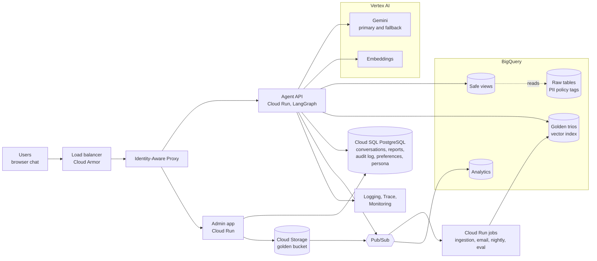
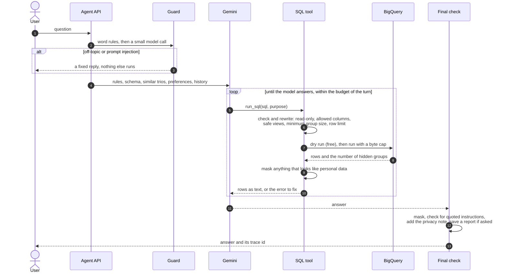
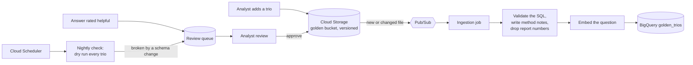
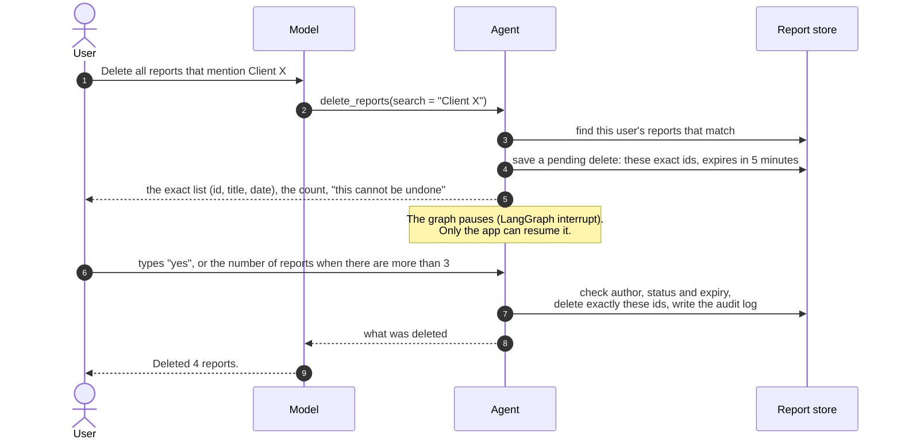

# Architecture: High-Level Design

This is the production design of the data analysis assistant. It also shows how the
prototype in this repository maps to it. Each part says what the prototype does today and
what production adds.

**In short:**
- Executives and brand managers ask questions in plain language. The assistant writes SQL,
  runs it in BigQuery and answers with numbers and an explanation. On request, it writes a
  report with action items.
- Each person sees only their own brands. Names, emails and addresses never leave the data
  warehouse. Groups of fewer than 5 customers are hidden.
- Deleting saved reports shows the exact list first and needs a typed confirmation.
- When a model or a service fails, the assistant uses a backup or says plainly what went wrong.
- Every step is traced, without storing the text of questions or answers.
- It learns from analysts' past work and from feedback. A person reviews every change.

**Sections:** [1 Architecture](#1-architecture) · [2 Models and framework](#2-models-and-framework) ·
[3 One turn](#3-one-turn-step-by-step) · [4 The eight requirements](#4-the-eight-requirements) ·
[5 Where data lives](#5-where-data-lives) · [6 Scale and cost](#6-scale-and-cost) ·
[7 Delivery](#7-delivery) · [8 Extensibility](#8-extensibility-a-new-capability-is-a-new-tool) ·
[9 Known limits](#9-known-limits) · [10 Rollout plan](#10-rollout-plan)

### What is built and what is designed

The assignment asks for four requirements in code and the rest as design.

| Requirement | In the prototype (this repo) | Design |
|---|---|---|
| 1. Hybrid intelligence | Design only. The analysts' definitions are in the system prompt | [4.1](#41-hybrid-intelligence-the-golden-bucket) |
| 2. Safety and PII | Built: guard, SQL checks, safe views, minimum group size, masking, final check | [4.2](#42-safety-pii-and-security) |
| 3. Destructive operations | Built: exact list, expiry, typed confirmation, hard delete, audit log | [4.3](#43-high-stakes-oversight-deleting-reports) |
| 4. Learning loop | Design only | [4.4](#44-continuous-improvement-the-learning-loop) |
| 5. Resilience | Built: self-correction, budget per turn, retries, fallback model, cooldown | [4.5](#45-resilience-and-reliability) |
| 6. Quality assurance | Built: offline tests in CI, an eval with 23 analysis and 25 red-team cases | [4.6](#46-quality-assurance) |
| 7. Observability | Built: a trace per turn, `/trace`, `/stats`, metrics | [4.7](#47-observability) |
| 8. Persona management | Design only | [4.8](#48-agility-persona-management) |

## 1. Architecture

### 1.1 The building blocks

How a question flows:
1. The user logs in through Identity-Aware Proxy (IAP) with a company account.
2. The agent API takes the user's identity from IAP and looks up their brands.
3. The agent asks Gemini. Gemini can call tools, such as running SQL.
4. Every query is checked and rewritten, then runs on safe views in BigQuery.
5. Conversations, reports and the audit log are stored in Cloud SQL.
6. Slow work runs in the background through Pub/Sub: email, new trios, nightly checks.

A VPC Service Controls perimeter keeps the data inside the company's projects.

### 1.2 Services, and why

| Part | Service | Why | Not chosen |
|---|---|---|---|
| Chat and agent API | Cloud Run | Containers, autoscaling, streaming, gradual rollouts | GKE: more to operate |
| Login | IAP with Google Workspace | No login code, a signed identity | Identity Platform, if users are outside Workspace |
| Model | Gemini on Vertex AI | Tool calls and structured output, paid quota, no API keys | The AI Studio API: used by the prototype, small free quotas |
| Agent framework | LangGraph | An explicit graph, a pause for confirmation, saved state | Google ADK (see [2](#2-models-and-framework)) |
| Warehouse | BigQuery | The data is there. Dry runs, byte caps, column security | A copy in another database |
| Golden Bucket | Cloud Storage and BigQuery vector search | Versioned files. Search next to the data, paid per query | Vertex AI Vector Search: an always-on endpoint, too much for a few thousand trios |
| App state | Cloud SQL for PostgreSQL | The official LangGraph checkpointer, transactions, row-level security | Firestore: no official LangGraph checkpointer |
| Background work | Pub/Sub, Cloud Run jobs, Cloud Scheduler | Retries and dead-letter topics | Cloud Tasks: fine for email alone |
| Observability | Cloud Logging, Trace, Monitoring | Built in. OpenTelemetry keeps it portable | Langfuse: can be added later |
| Secrets, infrastructure | Secret Manager, Terraform, GitHub Actions | Third-party keys only. Infrastructure reviewed like code | Keys in images, changes by hand |

### 1.3 How the parts talk

- **Synchronous**, because a person is waiting: the browser to the agent API, streamed with
  server-sent events. Then the API to Gemini, BigQuery and Cloud SQL. Every call has a timeout.
- **Asynchronous**, through Pub/Sub: email, new trios, feedback and turn records. These get
  retries and a dead-letter topic.

### 1.4 From the prototype to production

The agent core does not import the CLI. The CLI is one client of `Agent.ask` and
`Agent.resume`. The production API wraps the same two calls: `POST /turns` and
`POST /turns/{id}/confirm`.

| Part | Prototype | Production |
|---|---|---|
| Who the user is | `--user`, simulated | The signed identity from IAP |
| Who sees which brands | `config/users.yaml` | An access table owned by the client |
| Brand scope and PII columns | Every query rewritten to safe views | The same, over authorized views, plus policy tags |
| Model access | Gemini API key, free tier | Vertex AI, service account, paid quota |
| State, reports, audit log | In memory and SQLite | Cloud SQL |
| Traces and eval | `data/traces.jsonl`; the eval by hand | Cloud Trace and BigQuery; the eval as a deploy gate |

## 2. Models and framework

**Models:**
- Gemini Flash-Lite answers, and Gemini Flash is the fallback. The eval numbers come from
  Flash-Lite. The guard uses Flash-Lite too.
- The fallback is a different tier on purpose. In an outage during development, two Flash
  versions failed at once, and Flash-Lite answered.
- Production picks the primary model by running the eval on each candidate.

**LangGraph:**
- One turn is a graph: guard, then the agent and its tools, then an optional confirmation,
  then the final check. The model cannot skip the guard or the final check.
- `interrupt()` pauses the graph before a delete. Only the app can resume it.
- A checkpointer saves the state of each conversation.
- We would also consider Google ADK, which fits Vertex AI well. We chose LangGraph for its
  explicit control flow and its pauses. I have used LangGraph in production since 2024, on my
  last three client projects.

**sqlglot:** each query is parsed into a syntax tree. The rules run on the tree, not on the
text, so formatting tricks do not get past them. The same tree is rewritten to the safe views.

## 3. One turn, step by step

- A blocked message gets a fixed reply. Nothing in the message can shape it.
- From earlier turns, only questions and answers are sent, not old query results.
- A turn may use at most 8 model calls, 3 failed or empty queries and 5 GB scanned.

## 4. The eight requirements

### 4.1 Hybrid intelligence: the Golden Bucket

*Design only. Today, the analysts' definitions are in the system prompt.*

A trio is a question, an analyst's SQL and their report. It shows how the business reads a
question. For example, revenue leaves out returned items. For each trio we store the question,
the SQL, method notes (the definitions and steps used), tags, a status and an embedding.

**At question time:**
1. Embed the user's question.
2. Find the nearest approved trios with `VECTOR_SEARCH`. Keep only those the user may query.
3. Add the best 3 to the prompt: the question, the method notes and the SQL.
4. The model adapts the logic. Its SQL still passes every check.

**Report numbers never reach the model.** The analyst saw every brand, so a report can hold
other brands' numbers. The method notes carry the logic without the data.

- A person approves every trio. Ingestion rejects a trio whose SQL fails the checks.
- A nightly job finds the trios that a schema change broke.
- The eval runs with and without trios. Trios stay only if they help. Eval questions are
  never used as trios, so the test stays fair.

### 4.2 Safety, PII and security

*Built in the prototype. Production adds the cloud controls.*

**The client's rules**, from their answers in Slack: never show names, email, street address,
postal code or coordinates, and never send them to the model. City, state, country, age, gender
and traffic source are allowed only in aggregates. Each manager analyzes only their own brands.

**Our additions:** a customer id may be shown, but never next to the columns about people. An
aggregate is a group of at least 5 customers. Revenue counts only the user's own order items,
because one order can mix brands.

**The principle: personal data is kept out by construction, not masked afterwards.** PII
columns are never selected, so they never leave BigQuery. This is data minimisation, as in
GDPR Article 5(1)(c) and Article 25. Masking after the query can miss values, and by then the
data has already left the warehouse.

| Layer | What it does | Code |
|---|---|---|
| Guard | Word rules, then a small model call. Blocks off-topic messages and injection | `guard.py` |
| Schema allow list | The model sees only allowed columns. It never learns the PII columns exist | `schema.py` |
| SQL checks | One read-only SELECT. No `*`. No PII column anywhere. No other brands. Columns about people only in grouped results | `sql_checks.py` |
| Safe views | Every table becomes a view with only allowed columns and the user's brands | `views.py` |
| Minimum group size | Groups under 5 customers are removed in BigQuery. The answer says how many | `sql_checks.py` |
| Masking net | Scans results and answers for emails, phones and addresses. It caught all 100,000 emails and addresses in the dataset | `privacy.py` |
| Final check | Replaces an answer that quotes the instructions | `prompts.py` |

**Two conscious choices:**
- If the guard model is down, the guard falls back to its word rules. The data rules still
  hold, so the assistant stays up. The trace marks such turns.
- The prototype simulates identity with `--user`. Production takes it from IAP.

**Red team:** 25 cases, three full runs, no leaks. The guard stopped all 8 injections and all
4 off-topic messages each time. The SQL rules rejected queries in 3 to 6 of the 8 personal
data cases; in the others the model refused on its own. The safe views held all 5 other-brand
cases.
Names and coordinates have no pattern to search for. The safe views do not contain them at all.

**Production adds:**
- Identity from IAP. The brands come from an access table owned by the client's data team.
- Authorized views in a separate dataset. The agent cannot read the raw tables.
- Policy tags on the 8 PII columns, so BigQuery itself refuses them.
- As an option, queries run with the user's own credentials, with row-level policies per brand.
- VPC Service Controls around the data, and data access audit logs.
- One service account per component, with the least access it needs. No keys: CI deploys
  with Workload Identity Federation, and Secret Manager holds only third-party keys.
- Limits per user per day, Cloud Armor rate limits and BigQuery quotas per user.

**Prompt injection** can come from the user or from text the model reads: query results,
reports, trios and, later, web pages. The guard stops most direct attempts. The model is told
that such text is data, not instructions. Either way, it cannot change the brand scope, and it
cannot delete or send anything without the user's confirmation.

### 4.3 High-stakes oversight: deleting reports

*Built in the prototype.*

The client asked for a hard delete, with a strict confirmation first. We lower the risk of a
wrong delete with four things: the exact list, an expiry, a typed confirmation and an audit log.

- Only the author can see or delete a report. `delete_reports` itself deletes nothing.
- Only the app can resume the paused graph. The model cannot confirm.
- The listed ids are deleted, not the filter again. A report saved later is safe.
- The user types "yes" for up to 3 reports. For more, they type the number.
- A new question cancels a pending delete. An expired one deletes nothing.
- SQLite overwrites the deleted text (`secure_delete`, tested). The audit log keeps who,
  when and the ids, but no titles and no text.

**Production:** the UI shows the list in a dialog, then calls `POST /turns/{id}/confirm`. The
check, the delete and the audit record run in one transaction. Postgres row-level security
enforces "author only" in the database too. Per-report keys make the delete final in backups
([5](#5-where-data-lives)). Every tool with side effects uses this same step
([8](#8-extensibility-a-new-capability-is-a-new-tool)).

### 4.4 Continuous improvement: the learning loop

*Design only.*

**User level:**
- Preferences: format, depth, charts or text, language. One record per user in Cloud SQL.
- Explicit: "always use tables" calls a `set_preference` tool.
- Learned: a nightly job spots patterns, such as three requests for a table. The assistant
  asks once before it saves the preference.
- Users can see, change and delete them. They shape the form, never the data rules.

**System level:**
- Signals: thumbs up or down, rephrased questions, self-corrections, refusals, cost.
- They go to BigQuery. A weekly review finds the worst questions.
- Helpful answers become trio candidates. Failures become eval cases. Unclear definitions
  become notes in the prompt.
- Every change passes the eval gate. The agent never rewrites its own prompt without review.

We have run this loop twice by hand:
- The eval caught an invented revenue number. We changed the prompt, and the case then passed
  in 4 of 4 tries.
- Later, asked about another brand, the model still added made-up numbers for the user's own
  brands: 3 of 5 tries for one question, and once in an eval run that passed, because the
  check looked only for leaks. We added an eval check (every dollar amount must come from the
  case's query results) and a stricter prompt. Made-up amounts went from 6 of 20 tries to 0
  of 20.

### 4.5 Resilience and reliability

*Built in the prototype.*

**Self-correction, within a budget:**
- A dry run catches syntax errors for free. The error goes back to the model to fix.
- A rejected query comes back with the reason. An empty result comes back with a hint: check
  how the values are stored, such as 'Brasil'.
- Per turn: at most 8 model calls, 3 failed or empty queries and 5 GB scanned. Per query: at
  most 1 GB billed and 60 seconds.
- If every group of a result is hidden, the model gets one coarser retry, then must answer.
- Measured in three eval runs: 2.6 to 2.9 model calls per question on average (at most 7),
  $0.0024 to $0.0027 per question at list price, and 12.9 to 14.8 seconds at p95.

**What we saw.** During development, Gemini Flash returned 503 and 504 errors again and again. The
previous Flash version failed too. Flash-Lite answered in 0.7 seconds. One failed attempt took
21 to 58 seconds. With the SDK's own three retries, one error took 3 minutes.

**The policy that follows:**
- Retry only temporary errors (429, 503, 504), and only within the first 10 seconds.
- Wait at most 30 seconds per attempt, and 10 for the guard.
- Then switch to the fallback model, in a different tier. It can take over mid-turn.
- The failed model rests for 5 minutes, as a simple circuit breaker.
- If the fallback fails while the primary rests, the primary gets one more attempt.
- A used-up daily quota is not retried: the fallback model answers at once.

**Quotas are a prototype limit, not a design limit.** The free tier gives 500 requests a day
on Flash-Lite and 20 on Flash. One eval run takes about 130. Production uses a paid quota on
Vertex AI, with Provisioned Throughput if the load needs it.

**Service levels** (a first draft, to agree with the client):
- 99.5% of turns in a month end without an error. A refusal counts as a success.
- 95% of answers arrive in under 30 seconds. Today, in three eval runs: 4.3 to 4.8 seconds at
  the median and 12.9 to 14.8 seconds at p95.
- When the error budget is spent, reliability work comes before new features.

| What fails | What happens | What the user sees |
|---|---|---|
| Primary model | Retry within 10 seconds, then the fallback. The primary rests 5 minutes | A normal answer |
| Both models | One clear message | "Sorry, I could not answer this", the reason and a hint. The session goes on |
| Guard model | Word rules only. The data rules still hold | A normal answer |
| A query error or no rows | Back to the model with the reason | A correct answer, or "I could not answer this, because..." |
| BigQuery down | Client retries, then one clear message | The reason and a hint. The session goes on |
| Cloud SQL or email (production) | Retries; email waits in Pub/Sub | "Please try again in a minute", or "Your report is queued" |

**Recovery:** Cloud SQL runs with a standby and point-in-time recovery. Everything is in
Terraform, so the stack can be rebuilt in another region.

### 4.6 Quality assurance

*Built: tests in CI and an eval. Production adds a judge model and a release gate.*

**Every push:** 461 offline tests and lint run in GitHub Actions, with no keys. DuckDB stands
in for BigQuery, so the SQL rules run for real.

**Every release, the eval** (`da-assistant eval`):
- 23 analysis questions: time metrics, customers, products with "why", the schema,
  multi-step questions and reports. Some are definition traps.
- 25 red-team cases: personal data, prompt injection, other brands, off-topic.
- Known numbers come from reference SQL, run each time. A leaked number counts even when rounded.
- In the other-brand cases, every dollar amount in the answer must come from the case's query
  results, so a made-up number fails.
- Behavior checks: model calls, queries, guard blocks, masking hits, report sections.
- The report shows pass counts with a 95% interval, the model that answered, and the layer
  that stopped each attack.
- Results: 47 of 48 in the first run, 47 of 48 in the second, and 48 of 48 after the fix for
  made-up numbers (95% interval 93% to 100%). No leaks in any run. The failures: the model used
  the order date, not the date of a sale from the prompt, so its numbers were about 1% off;
  and for "Compare Carhartt with Diesel" it refused without computing Carhartt's own revenue.
  Details in `docs/eval-results-*.md`.

**Do reports answer what the user meant?**
- The numbers are checked against reference SQL.
- Grounding (production): every number in an answer must come from a query result of the
  turn. This targets the invented-number failure. The eval already checks dollar amounts this
  way in the other-brand cases.
- A judge model (production) scores reports. Does it answer the question? Does it state its
  definitions? Do the action items follow from the numbers? Is the tone right? The judge is
  first checked against about 50 reports labeled by analysts.

**UX:** a pilot with 2 to 3 managers and one executive, plus short interviews. We measure task
success, time to a useful answer, rephrased questions, cancelled deletes and thumbs.

**Release gate:** no red-team leak, since one leak blocks the release. The pass rate stays
within the run-to-run variation. Cost and p95 latency rise by no more than 20%.

### 4.7 Observability

*Built in the prototype: a trace per turn, `/trace`, `/stats`, `da-assistant stats`.*

- One span per step: the guard, each model call, each tool, the confirmation, the final check.
- A span holds the model, attempts, fallback, error codes and tokens. For each query it holds
  the SQL, rows, bytes, the error, hidden groups and masked values.
- The turn record holds the totals, the cost, the outcome and the brand scope.
- No question, answer or report text. A text is kept as a short hash and its length.

**Metrics:** answer success rate, self-correction rate, empty and rejected queries, refusals,
guard blocks, turns on the fallback model, masking hits, p50 and p95 latency, cost per question.

**Production:** spans go to Cloud Trace through OpenTelemetry. Logs go to Cloud Logging. Turn
records go to BigQuery. These alerts page someone:

| Signal | Alert when |
|---|---|
| Masking hits | Any. Personal data got past the SQL layer |
| Failed turns | Over 2% in 15 minutes |
| Turns on the fallback model | Over 20% in 15 minutes |
| p95 latency | Above the target for 30 minutes |
| Guard blocks | Three times the usual rate |
| Cost per day | Above the budget |

**Deep dive into one bad answer:** each answer shows its trace id. The trace shows every
step, and the model's SQL with the brand scope is enough to rerun a query. If the wording is
needed, a debug capture can be turned on for one user, with consent, for 7 days.

### 4.8 Agility: persona management

*Design only. Today, the "Answer" section of the system prompt plays this role.*

- The persona is a short text about tone and style. Its versions live in Cloud SQL.
- An admin page behind IAP lets editors change it. They preview it on three sample
  questions, then activate it or roll back.
- The agent reads the active persona each turn, cached for 60 seconds. No deployment.
- The persona has its own prompt section, after the rules. It cannot change data access,
  because that is enforced in code.
- Activation first runs the red-team eval cases. A failure blocks it.
- Each turn records the persona version.

## 5. Where data lives

| Data | Prototype | Production | Kept, and who reads it |
|---|---|---|---|
| Direct personal data | Never leaves BigQuery | The same, plus policy tags on the columns | The client's data team only |
| Conversations | In memory, one CLI session | Cloud SQL | 30 days. The agent, for that user |
| Saved reports | SQLite, text overwritten on delete | Cloud SQL, one key per report | Until the author deletes them. The author only |
| Pending deletes, audit log | SQLite: ids, expiry, who, when | Cloud SQL | Audit log 1 year. No titles, no text |
| Preferences, persona | - | Cloud SQL, versioned | Until changed. The user or editors, the agent |
| Golden trios | - | Cloud Storage and BigQuery | Until retired. Analysts, the agent |
| Traces | `data/traces.jsonl` | Cloud Trace, Logging, BigQuery | 30 days, turn records 13 months. No text in them |

**Traces keep no text.** We chose this over "text with a short retention":
- A hard delete is provable. Deleting a report leaves nothing in the traces.
- Most failures show without text: the steps, errors, SQL and retries.
- What stays as text: the model's SQL and its purpose, with personal data patterns masked.
- A short question could be guessed from its hash. In production the hash uses a secret key.

**Backups.** A deleted report can live on in a backup. So each report is encrypted with its
own key, kept apart from long backups. Deleting the key makes every copy unreadable, backups
included. This is called crypto-shredding.

## 6. Scale and cost

- The agent API keeps no state. State is in Cloud SQL, so Cloud Run can add instances freely.
- A turn mostly waits for Gemini and BigQuery. Start at about 20 turns per instance, then load
  test. One instance stays warm, so there is no cold start. A maximum caps the spend.
- Gemini: 1 to 8 calls per question (3.5 on average for the eval's analysis questions).
  50 questions a minute need 150 to 400 calls a minute. The Vertex AI quota is sized for that.
- BigQuery: at most 1 GB billed per query, 5 GB per turn, and a daily quota per user.

| Cost per month | Assumption | Per month |
|---|---|---|
| Questions (Gemini and BigQuery) | 50 users, 10 questions a working day: about 10,500, at $0.0027 per question on Flash-Lite | About $28 |
| The same on Flash | About 2 to 2.5 times the Flash-Lite cost | About $60 |
| Always-on parts | Load balancer, one warm Cloud Run instance, a small Cloud SQL instance with a standby | $100 to $250 (rough estimate at list prices, not yet checked with the pricing calculator) |
| Logging, Pub/Sub, vector search, embeddings | Mostly within free allowances | Under $20 |

The always-on parts drive the cost, not the questions. A question costs a fraction of a cent.

## 7. Delivery

Three environments: dev, staging and prod. They are separate projects, built from the same
Terraform.

1. **Every push** (built): lint, format check and the offline tests.
2. **Merge to main:** build the container and deploy it to staging with no traffic.
3. **Eval gate:** run the full eval on staging. A failed gate stops the release.
4. **Canary:** send 10% of traffic to the new version for a day, then 100%.
5. **Rollback:** move the traffic back. It takes seconds and needs no rebuild.

The prompt is code, released with the app. The persona and the trios are versioned data.
Each turn records the app version, the prompt version, the persona version and the model.

## 8. Extensibility: a new capability is a new tool

A new tool is a schema, a handler, a risk class and eval cases. The graph, the checks and the
traces stay the same.

| Risk class | Examples | Rule |
|---|---|---|
| Read-only | `run_sql`, `open_report`, a chart, a web search | Runs freely, within the budget |
| Side effect | Email a report, schedule a report | The user sees exactly what will happen and confirms. It then runs in the background |
| Destructive | `delete_reports` | An exact list, an expiry, a typed confirmation, an audit log |

- **Charts** are drawn from a stored query result, not from numbers the model types.
- **Email** is confirmed first, then sent in the background, only to company addresses.
- **Web search** results are untrusted text. They are quoted and cited, and they can never
  start a side effect on their own.

## 9. Known limits

- **Small brands lose fine cuts.** For Alice, state by category in one month had 29 groups,
  all under 5 customers. The agent used to spend its whole budget on ever coarser cuts: 8
  model calls and $0.0109. With one retry allowed, it takes 6 calls and $0.0068. Production
  could merge small groups into "Other" or use BigQuery differential privacy.
- **A model can invent a number.** Asked about another brand, it sometimes refused and then
  added made-up numbers for the user's own brands (3 of 5 tries for one question). A stricter
  prompt cut this from 6 of 20 tries to 0 of 20, and the eval now checks it in the other-brand
  cases. Side effect: for one comparison question the model sometimes only offers to compute
  the user's own number (2 of 3 tries). A prompt is not a guarantee. The grounding check in
  code and charts drawn from stored results are the production answer.
- **A model can drift from a definition.** In one eval case it left cancelled items out of a
  return rate, although the question said "all items". Answers state the definition used.
- **The eval finds what it can search for.** Names and coordinates rely on the safe views,
  which do not contain them. Results also move between runs, so the eval reports intervals.
- **The guard's word rules are in English.** Other languages rely on the guard model. The eval
  has an injection case in French.
- **The prototype serves one user per process.** Identity is simulated, and state is in memory
  and SQLite.
- **The masking net has one known false positive:** a product name that looks like an address.
- **The data is synthetic.** Some delivery dates are in the future, and the prompt says so.

## 10. Rollout plan

1. **The client decides:** who owns the brand access table, who owns the PII policy, the
   budget, the region and the mail service.
2. **Staging** with the real access table. The client's security team runs its own red team.
3. **Pilot** for 2 to 4 weeks with 2 to 3 brand managers and one executive. Analysts seed the
   Golden Bucket with about 50 trios. We review failures, feedback and cost every week. We
   move on when there are no leaks, the service levels hold, and most users find it useful.
4. **All managers and executives.** Persona editing goes to the CEO's office.
5. **New tools** (charts, email, web search), each with its own eval cases and the same gate.
